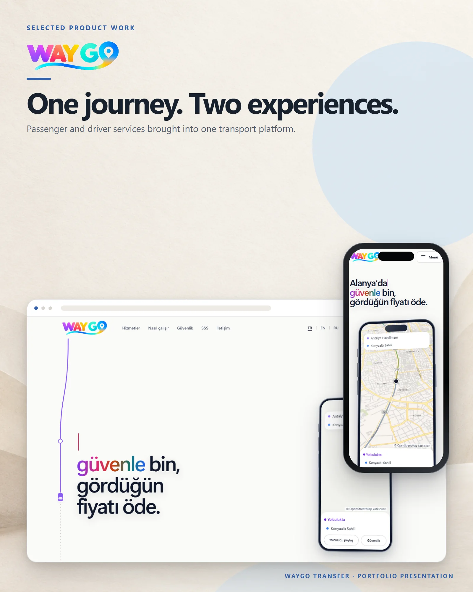

# WayGo Transfer

A multilingual transfer platform for Antalya, built around fixed prices, safety features and driver onboarding.

**Live:** [waygotransfer.com](https://waygotransfer.com) &nbsp;·&nbsp; **More work:** [github.com/mertomeroglu](https://github.com/mertomeroglu)

### Highlights

- Fixed-price journey concept and a four-step ride flow
- Safety, live tracking, trip sharing and private-call messaging
- Turkish, English and Russian public experience
- Entry points for passengers and drivers

### Built with

Next.js · React · TypeScript · Motion · Vitest · pnpm monorepo

---

Presentation-only repository: this README and two presentation images built from real product screens. Application source and private configuration are not published here. Visual content and brand assets remain the property of their respective owners — see [LICENSE](LICENSE).
