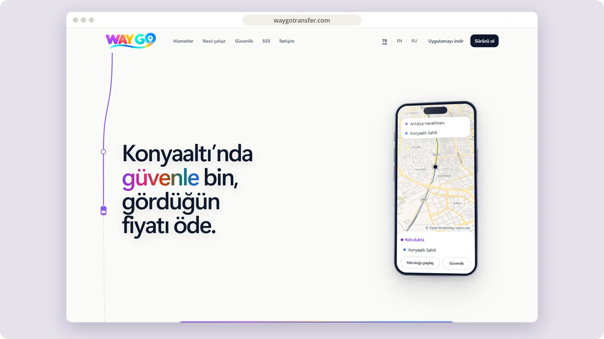

# WayGo Transfer

A multilingual transfer platform for Antalya, built around fixed prices, safety features and driver onboarding.

**[Visit waygotransfer.com ↗︎](https://waygotransfer.com)** &nbsp;·&nbsp; [More work by Mert Ömeroğlu](https://github.com/mertomeroglu)

### Highlights

- Fixed-price journey concept and a four-step ride flow
- Safety, live tracking, trip sharing and private-call messaging
- Turkish, English and Russian public experience
- Entry points for passengers and drivers

### Built with

Next.js · React · TypeScript · Motion · Vitest · pnpm monorepo

---

Presentation-only repository. Images are real, unmodified product screens in a simple frame; application source and private configuration are not published here. Brands and visual content belong to their respective owners — see [LICENSE](LICENSE).
