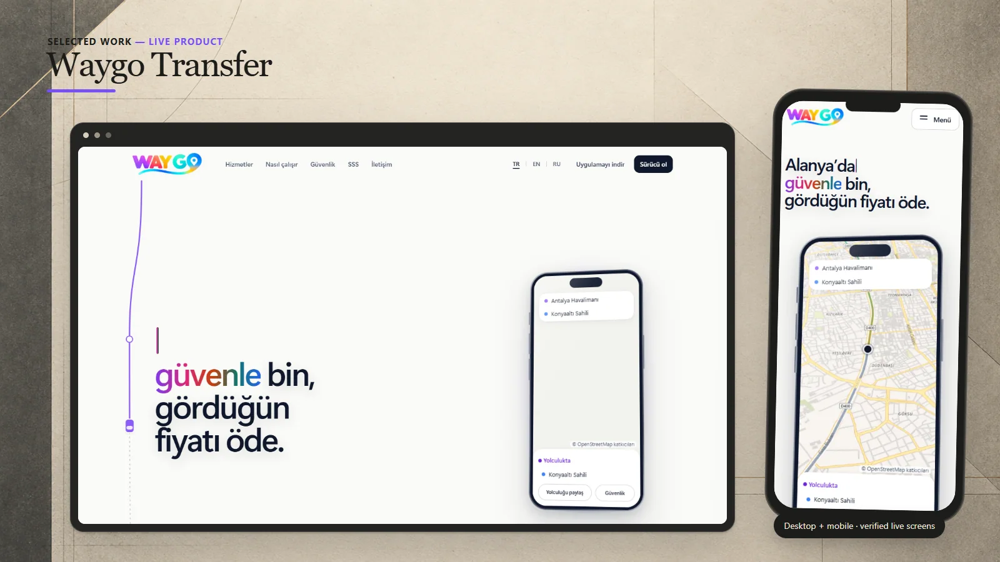
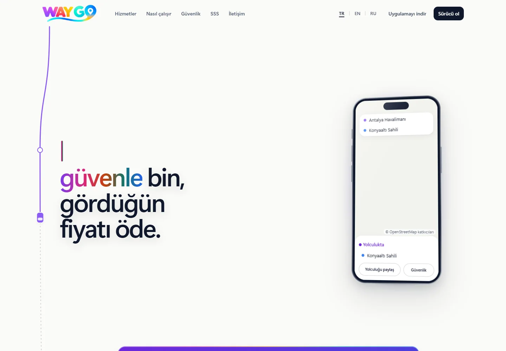
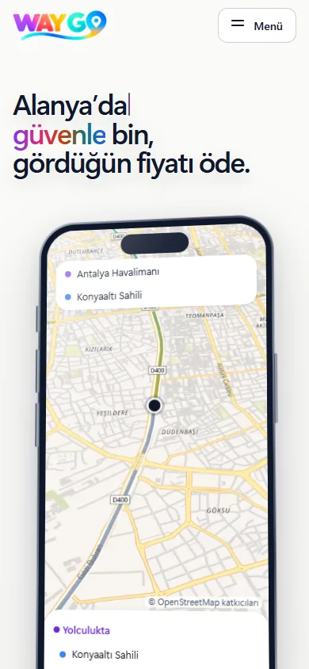

# Waygo Transfer

A multilingual mobility platform presenting fixed-price transfer flows, safety features, and driver onboarding for Antalya.

**[Visit live website](https://waygotransfer.com)**

## Highlights

- Fixed-price journey concept and four-step ride flow
- Safety, live tracking, trip sharing, and private-call messaging
- Turkish, English, and Russian public experience
- Driver and customer-oriented entry points

## Verified technology

Next.js, React, TypeScript, Motion, Vitest, and a pnpm monorepo are confirmed in the private source manifest.

## Live interface

 

## About this repository

This presentation-only repository contains selected public screenshots, this README, and a small static introduction page. Application source and private configuration are not published here.

Visual content and brand assets remain the property of their respective owners. See [LICENSE](LICENSE).
